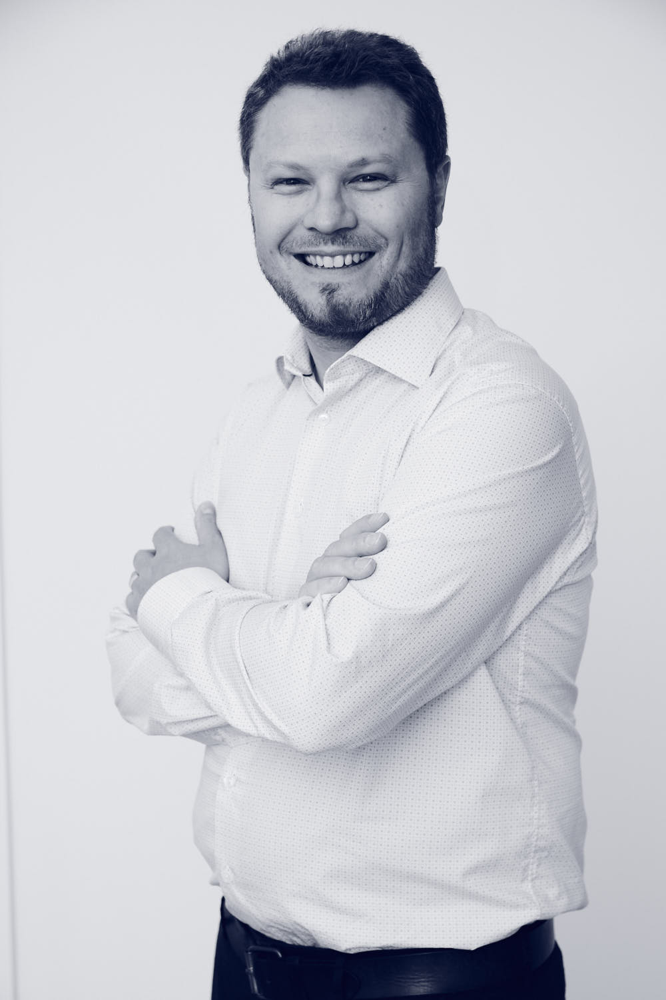

```{=html}
<section class="ab-hero">
  <div class="ab-photo"></div>
  <div class="ab-intro">
    <h1>Pierre Pinson</h1>
    <p class="ab-punch">I work with the mathematics of energy markets.</p>
    <div class="ab-links">
      <a class="btn-pp primary" href="mailto:p.pinson@imperial.ac.uk">Email</a>
      <a class="btn-pp" href="/files/ppinsoncv.pdf?v=2026-11">CV (PDF)</a>
      <a class="btn-pp" href="https://scholar.google.com/citations?user=V3DJKFkAAAAJ&amp;hl=en">Google Scholar</a>
      <a class="btn-pp" href="https://www.linkedin.com/in/pierrepinson">LinkedIn</a>
    </div>
  </div>
</section>

<section class="ab-now" aria-label="Current roles">
  <a class="ab-role" href="https://incommodities.com/"><span class="ab-org">inCommodities</span><span class="ab-what">Principal, leading research and translation</span></a>
  <a class="ab-role" href="https://www.imperial.ac.uk/design-engineering/"><span class="ab-org">Imperial College London</span><span class="ab-what">Professor, Dyson School of Design Engineering</span></a>
  <div class="ab-role"><span class="ab-org">Halfspace</span><span class="ab-what">Chief Scientific Advisor</span></div>
  <a class="ab-role" href="ijf.html"><span class="ab-org">Int. Journal of Forecasting</span><span class="ab-what">Editor-in-Chief, 2019 – 2026</span></a>
</section>
```

For more than 20 years, through research, teaching and consultancy, I have worked at the interface between data, AI and power systems and markets. My core focus is how to generate optimal value for society from data. I combine mathematics and statistics with applications in meteorology, power and energy, logistics and business analytics, and my main contributions are in [forecasting](research/forecasting.qmd), optimisation under uncertainty and game theory: probabilistic energy forecasting, trading strategies for renewable assets, [electricity market design](research/markets.qmd), and [data markets](research/data-markets.qmd).

I care about teaching as much as research. I have taught in French, English and Danish, and my video courses on YouTube, including the open course [Renewables in Electricity Markets](teaching/index.qmd), have been viewed around 300,000 times. In March 2026 I gave the DTU Ørsted Lecture, ["Can we predict the future of forecasting?"](https://www.youtube.com/watch?v=tOe7jf_pcB8).

::: {.ab-facts}
::: {}
[20+]{.ab-n} [years in forecasting and energy markets]{.ab-l}
:::
::: {}
[]{.ab-n} [[publications](publications.qmd)]{.ab-l}
:::
::: {}
[6×]{.ab-n} [Clarivate Highly Cited Researcher]{.ab-l}
:::
::: {}
[3]{.ab-n} [teaching languages: French, English, Danish]{.ab-l}
:::
:::

```{=html}
<section class="ab-career column-page">
  <h2>Career at a glance</h2>
  <p class="ab-hint">Hover or tap a bar or a milestone for details.</p>
  <div id="ab-timeline" class="widget">
    <div class="w-scroll"><svg viewBox="0 0 900 360" role="img" aria-label="Career timeline from 2002 to 2026, in four lanes: academia, industry and advisory, editorial, and recognition."></svg></div>
    <div class="ab-detail" aria-live="polite"><span class="ab-d-when"></span><strong class="ab-d-title"></strong><span class="ab-d-text"></span></div>
  </div>
</section>
```

## The full record

::: {.panel-tabset}

### Positions

::: {.timeline}
- [2026 –]{.when} Principal, inCommodities (Aarhus, Denmark)
- [2022 –]{.when} Professor, Imperial College London, Dyson School of Design Engineering
- [2022 –]{.when} Chief Scientific Advisor, Halfspace (Copenhagen; acquired by Accenture, now part of Faculty)
- [2022 –]{.when} Affiliated Professor of Operations Research and Analytics, Technical University of Denmark, Department of Technology, Management and Economics
- [2023 –]{.when} Associated Research Fellow, CoRE, Aarhus University
- [2025 –]{.when} International Expert, Innovation Fund Denmark
- [2019 – 2026]{.when} Scientific Advisor and Angel Investor, Atmo (acquired by Vaisala)
- [2021 – 2022]{.when} Professor of Operations Research, Technical University of Denmark
- [2013 – 2020]{.when} Professor of Energy Analytics and Markets, Technical University of Denmark
- [2010 – 2011]{.when} Scientist, European Centre for Medium-Range Weather Forecasts (Reading, UK)
- [2008 – 2013]{.when} Associate Professor, Technical University of Denmark, Department of Applied Mathematics and Computer Science
- [2006 – 2008]{.when} Postdoctoral Fellow, then Assistant Professor, Technical University of Denmark, Department of Applied Mathematics and Computer Science
:::

### Editorial

::: {.timeline}
- [2019 – 2026]{.when} Editor-in-Chief, International Journal of Forecasting
- [2019 –]{.when} Director, International Institute of Forecasters
- [2021 – 2026]{.when} Associate Editor, OR Spectrum
- [2022 – 2024]{.when} Associate Editor, Scientific Data (Nature)
- [2014 – 2019]{.when} Associate Editor, then Editor, International Journal of Forecasting
- [2010 – 2019]{.when} Editor, Wind Energy
- [2011 – 2016]{.when} Editor, IEEE Transactions on Power Systems (and IEEE Power Engineering Letters)
:::

### Honours

::: {.timeline}
- [2026]{.when} DTU Ørsted Lecture, Technical University of Denmark
- [2026]{.when} Winner, EPRI AI-ccelerate Unit Commitment competition
- [2024]{.when} INFORMS Franz Edelman Award, lead of the winning team (with Halfspace and Molslinjen)
- [2024]{.when} Beijing Foreign Scholar, Peking University
- [2019 – 2025]{.when} Clarivate Highly Cited Researcher (cross-field): 2019–2023 and 2025
- [2020]{.when} IEEE Fellow
- [2019]{.when} Simons Fellow, Isaac Newton Institute for Mathematical Sciences, Cambridge
- [2018]{.when} IDA Elektropris
- [2017]{.when} Emerald Citation of Excellence
:::

### Visits

::: {.timeline}
- [2019]{.when} Simons Fellow, Isaac Newton Institute for Mathematical Sciences, Cambridge (3 months)
- [2016]{.when} Visiting Professor, École Normale Supérieure de Rennes
- [2010 – 2011]{.when} Scientist, European Centre for Medium-Range Weather Forecasts (Reading, UK)
- [2009]{.when} Visiting Researcher, University of Washington, Department of Statistics
- [2009]{.when} Visiting Researcher, University of Oxford, Mathematical Institute
:::

### Education

::: {.timeline}
- [2006]{.when} Ph.D. in Energy Engineering (forecasting, stochastic optimisation), École des Mines de Paris
- [2002]{.when} M.Sc./M.Eng. in Applied Mathematics, INSA Toulouse
:::

:::
