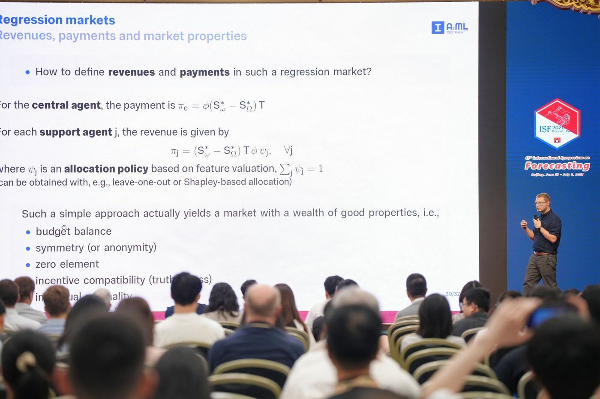
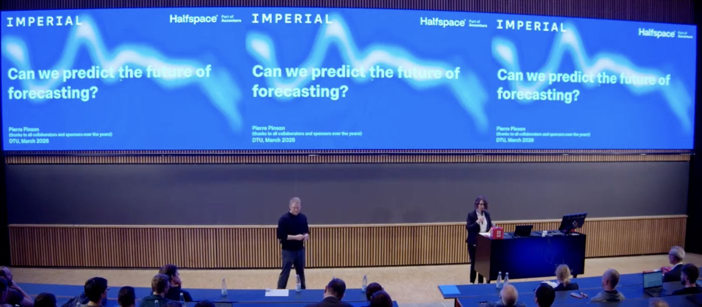
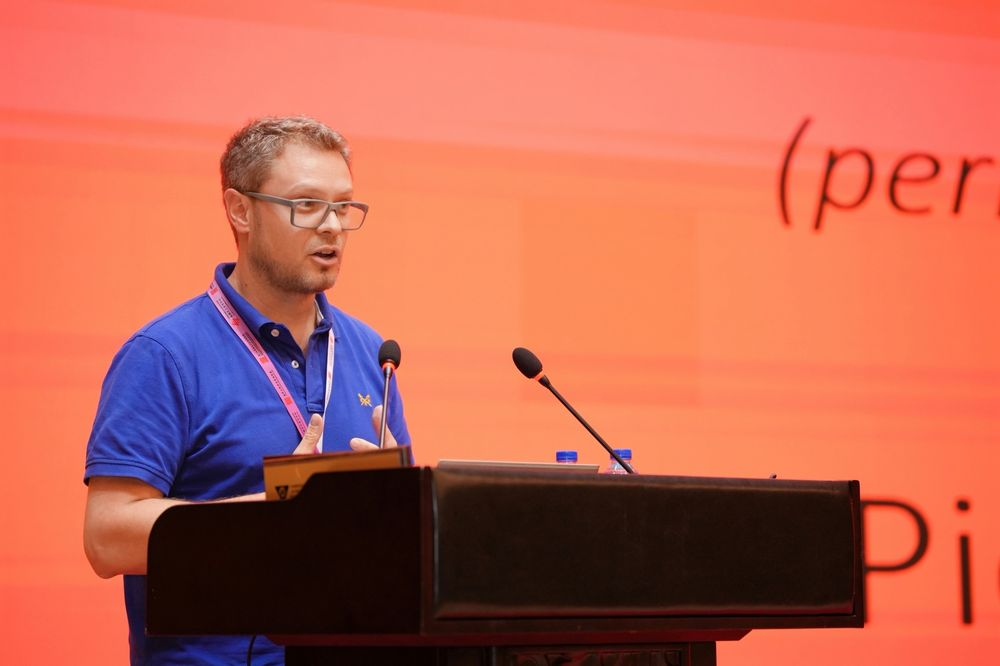
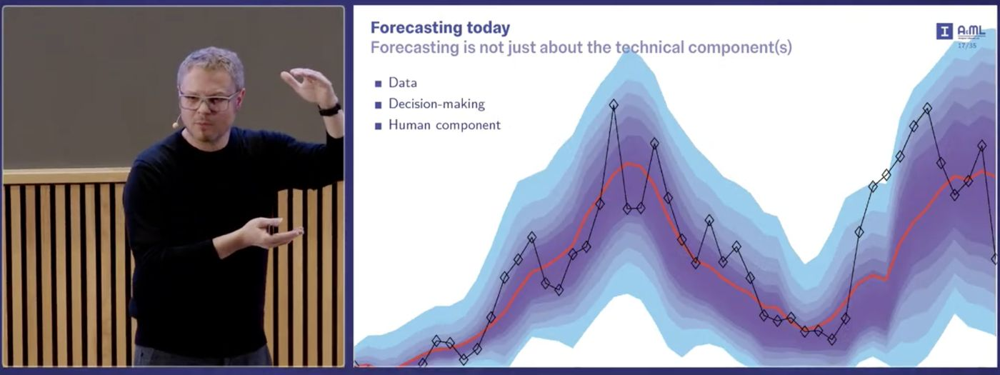

```{=html}
<section class="band sp-hero">
  <div class="sp-hero-grid">
  <div>
  <p class="sp-kicker">Speaking</p>
  <h1>Talks on forecasting, AI, data and the future of energy markets</h1>
  <p class="sp-lede">I speak to research communities, energy and trading companies, policy-makers and the wider public about how to make good decisions under uncertainty, and what that means for the energy transition. Talks draw on more than 20 years of research and on practice in industry, from award-winning forecasting at Molslinjen to energy trading at inCommodities.</p>
  <div class="sp-actions">
    <a class="btn-pp primary" href="mailto:p.pinson@imperial.ac.uk?subject=Speaking%20invitation&amp;body=Event%3A%20%0ADate%20and%20place%20(or%20online)%3A%20%0AAudience%20and%20size%3A%20%0AFormat%20and%20length%3A%20%0ATopic%20you%20have%20in%20mind%3A%20">Invite me to speak</a>
    <a class="btn-pp" href="#talks">See the talks</a>
  </div>
  <ul class="sp-facts" aria-label="At a glance">
    <li><strong>DTU Ørsted Lecture</strong> 2026</li>
    <li><strong>Keynote</strong> at the International Symposium on Forecasting 2025</li>
    <li><strong>English, French, Danish</strong></li>
  </ul>
  </div>
  <figure class="sp-hero-photo"><figcaption>Keynote at ISF 2025, Beijing</figcaption></figure>
  </div>
</section>
```

## Watch a recent talk

::: {.sp-video}
::: {}

:::
::: {}
### Can we predict the future of forecasting?

The DTU Ørsted Lecture, March 2026: a yearly public lecture at the Technical University of Denmark, often given by Nobel laureates. It covers where forecasting comes from, what AI is changing, and why the value of a forecast lies in the decisions it supports.
:::
:::

```{=html}
<section id="talks" class="sp-talks">
  <h2>Talks I give</h2>
  <p class="sp-intro">Each talk is tailored to its audience, from a technical keynote to a briefing for a board. Choose an audience to see what fits best.</p>
  <div class="chips sp-filter" role="group" aria-label="Filter talks by audience">
    <button type="button" class="chip" aria-pressed="true" data-aud="all">All audiences</button>
    <button type="button" class="chip" aria-pressed="false" data-aud="research">Research and academia</button>
    <button type="button" class="chip" aria-pressed="false" data-aud="industry">Energy and trading industry</button>
    <button type="button" class="chip" aria-pressed="false" data-aud="policy">Policy and regulation</button>
    <button type="button" class="chip" aria-pressed="false" data-aud="public">General public</button>
  </div>
  <div class="sp-grid">
    <article class="sp-talk" data-aud="research industry public">
      <span class="sp-tag">Forecasting and AI</span>
      <h3>Can we predict the future of forecasting?</h3>
      <p>Where forecasting has come from, what AI and foundation models change, and what they do not: uncertainty, verification and the value of forecasts for decisions.</p>
    </article>
    <article class="sp-talk" data-aud="policy industry public research">
      <span class="sp-tag">Energy markets</span>
      <h3>What may future electricity markets look like?</h3>
      <p>Why markets designed for controllable power plants must be rethought for renewables, flexible consumers and data, and what fit-for-purpose markets could look like.</p>
      <a class="sp-more" href="research/future-markets.html">Background: my take on future electricity markets</a>
    </article>
    <article class="sp-talk" data-aud="research industry policy">
      <span class="sp-tag">Data sharing</span>
      <h3>Let's learn to share: better forecasts through data sharing</h3>
      <p>How collaborative analytics, data markets and privacy-preserving learning can unlock the value of data spread across competitors, and how to pay contributors fairly.</p>
      <a class="sp-more" href="research/data-markets.html">Background: data and analytics markets</a>
    </article>
    <article class="sp-talk" data-aud="industry">
      <span class="sp-tag">From research to impact</span>
      <h3>From forecasts to decisions in daily operations</h3>
      <p>What it takes to turn forecasting, optimisation and dynamic pricing into everyday operations, told through the INFORMS Edelman Award-winning work at Molslinjen.</p>
      <a class="sp-more" href="news/posts/2024-edelman/index.html">The Edelman story</a>
    </article>
    <article class="sp-talk" data-aud="research industry">
      <span class="sp-tag">Probabilistic forecasting</span>
      <h3>Renewable energy forecasts ought to be probabilistic</h3>
      <p>Why point forecasts are not enough for wind and solar power, how to produce and verify probabilistic forecasts, and how traders and system operators use them.</p>
      <a class="sp-more" href="research/forecasting.html">Background: probabilistic forecasting</a>
    </article>
    <article class="sp-talk" data-aud="public policy research">
      <span class="sp-tag">The energy transition</span>
      <h3>Data, people, markets and the energy transition</h3>
      <p>A broad view of how data, people and markets interact in decarbonising our energy systems, first given as my inaugural lecture at Imperial College London.</p>
    </article>
  </div>
  <p class="sp-empty" hidden>No talk matches this audience yet: get in touch and we will shape one together.</p>
</section>
```

```{=html}
<section id="watch" class="sp-watch">
  <h2>Watch and listen</h2>
  <p class="sp-intro">More recordings of talks, and a podcast on forecasting.</p>
  <div class="sp-clips">
    <figure class="sp-clip">
      <button type="button" class="sp-thumb" data-yt="LyTyY4Dt5Vo" aria-label="Play: Let's learn to share: better forecasts through data sharing">
        
        <span class="sp-play" aria-hidden="true"></span>
      </button>
      <figcaption><span class="sp-when">2025 · Keynote, International Symposium on Forecasting</span><a href="https://www.youtube.com/watch?v=LyTyY4Dt5Vo">Let's learn to share: better forecasts through data sharing</a></figcaption>
    </figure>
    <figure class="sp-clip">
      <button type="button" class="sp-thumb" data-yt="e7uMRluA01M" aria-label="Play: Statistical and machine learning for forecasting">
        
        <span class="sp-play" aria-hidden="true"></span>
      </button>
      <figcaption><span class="sp-when">2019 · DTU summer school on data-driven analytics</span><a href="https://www.youtube.com/watch?v=e7uMRluA01M">Statistical and machine learning for forecasting</a></figcaption>
    </figure>
    <figure class="sp-clip">
      <button type="button" class="sp-thumb" data-yt="rRpxc_PpXMg" aria-label="Play: Consumer-centric electricity markets">
        
        <span class="sp-play" aria-hidden="true"></span>
      </button>
      <figcaption><span class="sp-when">2018 · DTU summer school on optimisation in energy systems</span><a href="https://www.youtube.com/watch?v=rRpxc_PpXMg">Consumer-centric electricity markets</a></figcaption>
    </figure>
  </div>
  <ul class="sp-audio">
    <li><span class="sp-when">2021 · Podcast</span><a href="https://forecastingimpact.buzzsprout.com/1641538/9180006-pierre-pinson">Forecasting Impact</a>, on energy forecasting, the IJF and the future of forecasting</li>
  </ul>
</section>
```

```{=html}
<section class="sp-pics" aria-label="Photos from recent talks">
  <h2>On stage</h2>
  <div class="sp-mosaic">
    <figure class="m-a"><figcaption>Regression markets, ISF 2025 keynote, Beijing</figcaption></figure>
    <figure class="m-b"><figcaption>DTU Ørsted Lecture 2026</figcaption></figure>
    <figure class="m-c"><figcaption>Presenting the IJF best paper award, ISF 2025</figcaption></figure>
    <figure class="m-d"><figcaption>"Forecasting is not just about the technical components", Ørsted Lecture</figcaption></figure>
  </div>
</section>
```

## Formats

::: {.sp-formats}
::: {}
#### Keynotes
For conferences and company events, typically 30 to 60 minutes with questions.
:::
::: {}
#### Panels and fireside chats
Discussions on forecasting, AI, energy markets and the energy transition.
:::
::: {}
#### Executive briefings
Focused sessions for leadership teams and boards on what forecasting, data and AI can bring to their business.
:::
::: {}
#### Masterclasses and workshops
Half-day or full-day sessions on probabilistic forecasting, trading under uncertainty or electricity markets, drawing on my [open course](teaching/index.qmd).
:::
:::

## Selected past talks

::: {.timeline}
- [2026]{.when} DTU Ørsted Lecture, Technical University of Denmark: "Can we predict the future of forecasting?"
- [2026]{.when} Carnegie Mellon Electricity Industry Center: "AI at the core of future electricity markets"
- [2025]{.when} Karlsruhe Institute of Technology: "Collaborative and market-based analytics and forecasting"
- [2025]{.when} Lancaster University: "Improving forecasts through data markets"
- [2025]{.when} Keynote, International Symposium on Forecasting (ISF 2025): "Let's learn to share: better forecasts through data sharing"
- [2024]{.when} Inaugural lecture, Imperial College London: "Data, people, markets and the energy transition"
- [2020]{.when} Probabilistic Methods Applied to Power Systems (PMAPS): "Now that we are getting so much data, what do we do with it?"
- [2020]{.when} Power Systems Computation Conference (PSCC): "Big data analytics in future electricity grids"
- [2018]{.when} MIT and University College Dublin: "Community and peer-to-peer electricity markets"
- [2018]{.when} University of Waterloo: "Show me your forecast, I will show you mine! Are we going towards energy data markets?"
- [2017]{.when} University of Oxford, ETH Zurich and Institut Henri Poincaré: "Community and peer-to-peer electricity markets"
- [2017]{.when} International Symposium on Forecasting, Cairns: "Wind power forecasting: nonlinearity, dimensionality and sharing aspects"
- [2015]{.when} ETH Zurich and TU Eindhoven: "Towards future electricity markets with large penetration of renewable generation"
- [2014]{.when} Tsinghua University, University of Hong Kong, Université Paris 7 and University of Bonn: "Offshore wind power fluctuations: modelling and forecasting"
- [2013]{.when} German Weather Service (DWD), and WIPFOR, Paris: "Renewable energy forecasts ought to be probabilistic!"
:::

```{=html}
<section class="band sp-cta">
  <h2>Planning an event?</h2>
  <p>Tell me about your event, its date and place (or whether it is online), the audience and the format you have in mind. I am based in Aarhus, Denmark, travel regularly across Europe, and also speak online.</p>
  <a class="btn-pp primary" href="mailto:p.pinson@imperial.ac.uk?subject=Speaking%20invitation&amp;body=Event%3A%20%0ADate%20and%20place%20(or%20online)%3A%20%0AAudience%20and%20size%3A%20%0AFormat%20and%20length%3A%20%0ATopic%20you%20have%20in%20mind%3A%20">Invite me to speak</a>
</section>
```
